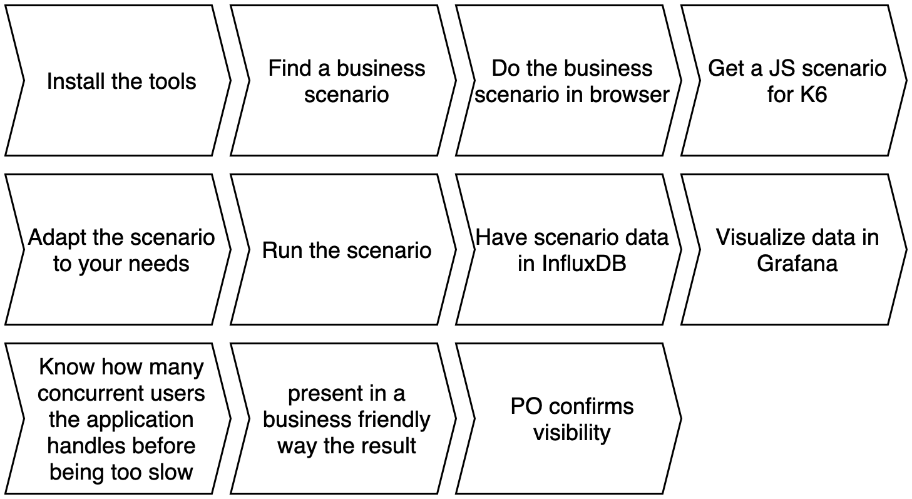
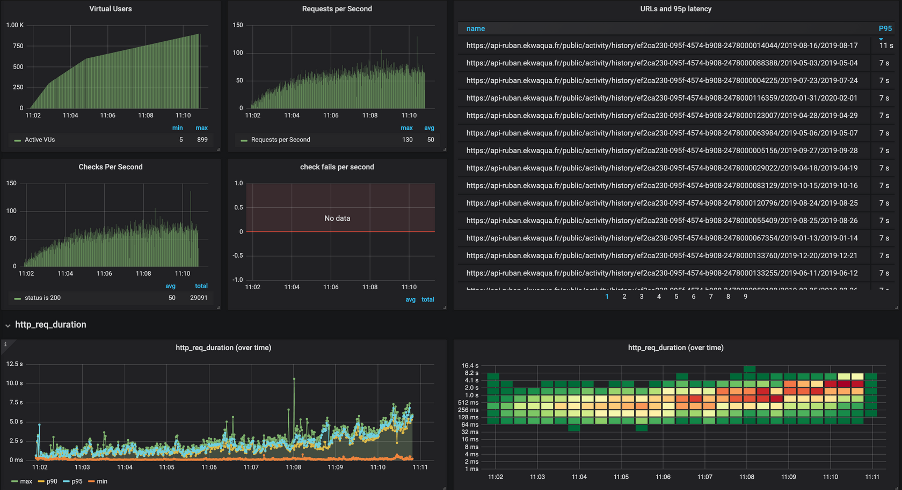
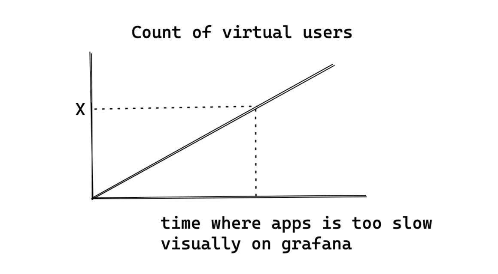
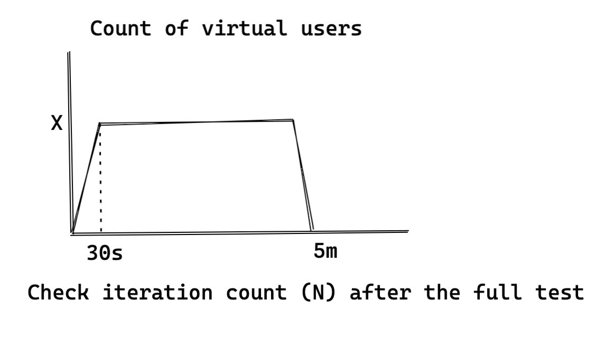

# load test boilerplate

## This README is long, you should use the table of content in Details section to find the relevant part to read for your problem.

## Technical prerequisites

- [Node.js](https://nodejs.org/en/) installed (use can use [nvm](https://github.com/nvm-sh/nvm) to do so)
- [Docker](https://docs.docker.com/get-docker/) installed
- [Docker Compose](https://docs.docker.com/compose/install/) installed

## Prerequisites

- **Know the charge the platform should handle to achieve business success**
- Have an iso prod infrastructure
- Have enough features to test a business relevant scenario

## Tools

- [k6](https://k6.io/docs/)
- [InfluxDb](https://www.influxdata.com/products/influxdb-overview/)
- [Grafana](https://grafana.com/grafana/)

## Perform a test

For Theodo people you can watch a
[demo video](https://www.notion.so/m33/Demo-for-K6-a89cdec0aa184b96a713ee505137efb4).

- make sure you **understand** ["Key points of the documentation"](#key-points-of-the-documentation)
- start docker containers `docker-compose up -d` (make sure ports of docker-compose are available: 3000)
- to create an HAR:
  - open Chrome with inspector opened
  - navigate as a regular user on a path relevant for your
    business. Please avoid scenario that contains non GET http calls
    at first (authentication for instance). If you do, please refer to
    the [Create a scenario](#create-a-scenario) section to avoid
    common problems.
  - after filtering the domains you want to test, right click on any item of network and on "save all as HAR", put it into `./scripts`
- convert the HAR into a scenario, you will **need** to give it a name (do not forget to `npm install`):
    `./node_modules/.bin/har-to-k6 -o scripts/my-scenario.js --add-sleep <(./node_modules/node-jq/bin/jq -s '.[0].log.options = .[1] | .[0]' scripts/my-scenario.har scripts/options.json)`
- run the test: `docker-compose run --rm k6 run /scripts/my-scenario.js`
- connect to [http://localhost:3000](http://localhost:3000), you should see Grafana UI
- import the dashboard:
  - copy content of `./visualisation/grafana-dashboard-config-to-import.json` (`cat ./visualisation/grafana-dashboard-config-to-import.json | pbcopy`)
  - click "+" > click "import" > paste json content > click "Load" > click "Import"

## What does the boilerplate add?

- This README with some commands to run
- This README with some explanations of the tools, the steps and how to customize them
- An **example of script** with comments to help you create a custom script (`./scripts`)

This exemple script is a good entry point to understand what the
generated scenario does without reading the whole README.

- A json to configure your dashboard in grafana (`./visualisation`)
- A docker-compose file that binds the tools together
- A simple node js scripts that computes the maximum number of concurrent users before tested applications becomes slow (`./analyse`)
- A json file that let you configure the previous script (`./analyse`)
- A json file with default options for a scenario (`./scripts`)

## Details

The goals of this part are to make you as autonomous as possible to
make your first basic tests and to feel confident to be able to make
it more complex once you have experimented all this.

First we'll see what we talk about, then what tools we use and what
they do and finally we we'll see details of what you do when you
perform a test.

**To troubleshoot the "Perform a test" part go directly to "Key points
of the documentation". If you want some background first, you can read
linearly.**

Practical advice will be put as quotes to make them easier to find.

- [Process](#process)
- [Concepts](#concepts)
  - [Load test](#load-test)
  - [Lexic](#lexic)
  - [Metrics](#metrics)
- [Tool choices](#tool-choices)
  - [Engine](#engine)
  - [Data collection](#data-collection)
  - [Visualisation](#visualisation)
- [Key points of the documentation](#key-points-of-the-documentation)
  - [Setup](#setup)
  - [Create a scenario](#create-a-scenario)
  - [Running a scenario](#running-a-scenario)
  - [Visualize the test when it runs](#visualize-the-test-when-it-runs)
  - [Analyse the results](#analyse-the-results)

To be autonomous you need to understand:
- what is a test?
- what are the elements of the test?
- what to look for during a test?
- what are the roles of the tools we use?
- how they interact?
- what to test?
- how to write the scenario that suits your needs?
- what to tell your PO to make him confident (if he should be)?

### Process

The steps are:



You should take one hour to perform the first test with someone's
help.

If you want to try it alone you should take from 30 minutes to give a
try to the "Perform a test" to two hours to understand what is in this
document.

### Concepts

#### Load test

What is a load test. You can find good definitions with google but
basically for us it will be the process to look at the behavior of our
application under a controlled charge.

Ok but what kind of charge? Here the business becomes important. The
number of users and what they do is driven by business, but you should
know your application enough to have a good scenario in mind. The PO
can help to set a good target but only once you have translated your
scenario to concrete business examples.

There are two main ways to test.

One is to put charge on specific route(s), this usually gives you a
number of request per second (or minutes) the application can
stand. This is usually bad because you cannot say anything about
business. However this is useful to compare with technical metrics of
an old system replaced by a new one because the technical metrics are
available for a real business load.

*For instance if you change ElasticSearch version, You can know the old
system works since you use it every day. If we compare with the same
artificial charge the old system and the new systems, and the new one
performs better, it is good enough to be confident in deploying the
new system.*

The other way is to play a complete scenario. For instance there is a
critical path for users like filling a form accross several pages to
get informations in the end. In this case you do not care about
requests per second, but you care that enough users can get through
the process in some amout of time because if users rush to your
plateform in a short time span you want to know how many can fill it
(with acceptable response time and error rate) during that time. This
way is very useful for business.

*You can present data like. There are X many occurences in a year, we
observed that this scenario can be played X times in ten minutes this
means you need 30 hours to perform the whole year so you should be
fine. You can also present the number of concurrent users on the
platform during this typical scenario.*

>This boilerplate focuses on testing with scenario but testing only
>some specific routes is easier to setup.

#### Lexic

Some other words are presented in their own part but these are
important to talk about load test in general.

- **vus**: virtual users. In our case a vitual user runs the same code
  over and over throughout the test. When there are 10 virtual users,
  it means there are ten loops in parallel executing the same code
  (the code can be dynamic).
- **iterations**: a complete scenario executed by a virtual user, so
  if a scenario last 2 minutes and we have 20 virtual users after 10
  minutes of test we will have 10/2*20 = 100 iterations.
- **stage**: the subpart of a test where you apply a linear change in
  the number of virtual users (e.g. from 100 vus to 200 vus in 3
  minutes)

#### Metrics

This part is already discussed above, here we take the metrics point
of view.

The three main metrics are:
- **request per seconds** (or minutes), this is good to compare two
  systems but does not say much on the business.
- number of **virtual users** useful to perform extrapolation of what
  it means in term of business regarding the duration of the
  scenario. *Be careful this is highly variable if you perform the
  same scenario two times faster, there are good chances the number of
  max simultaneous users will be half what it was because the load on
  the server will be twice higher. The extrapolation remains good
  because the duration is used to convert a number of simultaneous
  users to a number of users who can perform a complete task in a
  certain amount of time.*
- number of **iterations**: basically it the same as above except you
  do not need to make extrapolations. It is the number of times the
  single vu iteration has been completed. *Be careful this number is
  accurate only if you perform the test with the right load during the
  whole process. If you have only a few vus at the beginning and then
  ramp up it will impact the total number of iterations*

>It is recommended to extrapolate from the max vus and iteration duration,
>this allows you to explore different loads in different stages and
>find the limit if possible.

>It is a big bonus if you have a way to monitor the performance of
>your app during the tests. *It can help you notice if your
>autoscalling works well, if the latency is due to your database or to
>your code base, is your cache good enough, what are the ratio of
>cache hit/miss, what sizes of cache is used...*

>Requests per second does not seem quite a good metric since the
>system usually have the same number of request per second before and
>after it fails. This is due to the fact that when under load the
>system takes more time to respond preventing higher request per
>second.*

*there are some development on K6 to make the request rate independent
 of the response time of the system.

### Tool choices

#### Engine

There are lots of comparison on load testing tools online. To choose
K6 we used some criteria and a biased yet instructive comparison from
K6
https://k6.io/blog/comparing-best-open-source-load-testing-tools. What
it claimed was crossed checked with other comparison and finally we
chose their products.

The key insteresting caracteristics are:
- **performance** because we want the developpers to be able to
  perform tests quickly which means on their laptop (no need for cloud
  at first). *K6 is written in Go with a focus on performance. When
  you look at the performance comparison K6 is not the fastest. Yet we
  could in practice generate a load of 4000 requests per minutes with
  a 2013 macbook pro.*
- ease to test **simple cases**, with the generation of the scenario
  from the navigator, there is not much overhead to create a simple
  test. *Other tools like Vegeta are even faster and easy to use but
  they lack the next feature.*
- possibility to **script** a test. K6 allows to script scenario by
  writting JS code, others use Scala, XML, custom DSL, LUA. With JS
  code every developper at Theodo can easily edit the scenario. *Even
  if we should limit complex scripting which would limit (or ruin)
  performance it is important to be able to make some things dynamic
  for instance to avoid caching, or to create uniq objects because we
  have unicity constraints in our app or to get an id in a response to
  play with this id in the nexts request in order to have proper
  rights.*
- **documentation** obviously. We did not read all documentations of
  all technologies but since we are using K6, we found the
  documentation quite good to help solve problems.

With this in mind we tend to agree with the author that for our use
case K6 has the better tradeoffs.

If you want to understand more what is possible you should definitely
spend 2 hours reading the doc, at least to know what you can find in
the doc. https://k6.io/docs/

#### Data collection

K6 can have several outputs. InfluxDB which is a timeseries database
and have a close to SQL syntax is used here. Even if you should not
need to make queries yourself it is good to know it is an option. You
only need to trust your SQL instincts and correct them with the
documentation
https://docs.influxdata.com/influxdb/v1.8/introduction/get-started/

*It may not be perfect, We have read about some performance issues but
never experienced a problem ourselves probably because the amount of
data is fairly low compared to real use cases.*

#### Visualisation

The K6 console output is helpful but a bit (a lot) dry to perform an
analysis. Thanks to the influxDB output it is easy to have whatever
you want displayed in Grafana. Of course you do not want to create
queries and dashboard yourself at first that's why it is provided in
this repository and largely inspired or copied from K6 documentation.

Grafana is a complex tool but for our use case it basically is a
dashboard with visualisations of a set of queries to a datasource. The
preconfigured datasource is influxDB and a good dashboard to begin
with can be imported by copy pasting a json
(`visualisation/grafana-dashboard-config-to-import.json`).

If you want to change a configuration in your Grafana here is the doc
https://grafana.com/docs/grafana/latest/getting-started/getting-started/

### Key points of the documentation

**What is explain will broadly remain true, however the technical
parts may become outdated, in case of doubt please refer to the
original documentations for the syntax**

This parts will only focus on explaining important parts of what's
going on in the commands listed to perform a test.

#### The exemple scripts

You may want to explore the
[exemple script](./scripts/example-custom-scenario.js) to understand
where some of the explanations of the
["Create a scenario"](#create-a-scenario) and
["Running a scenario"](#running-a-scenario) may be used. The example
script is a quicker way to understand basic problems and how to modify
(or create) your scenario.

Other exemple are provided. This list may not be explicit, please look
directly in [scripts](./scripts) to see if you may use some exemple.

#### Content

- [Setup](#setup)
- [Create a scenario](#create-a-scenario)
- [Running a scenario](#running-a-scenario)
- [Visualize the test when it runs](#visualize-the-test-when-it-runs)
- [Analyse the results](#analyse-the-results)

#### Setup

First you `docker-compose up` the containers. There is a container for
each tool, InfluxDB and Grafana need to run in background but K6 is
used to run a test (it is normal if the status is exited since there
is nothing to do). The ports are binded to your host so you can play
with Grafana.

>The important parts are:
>- influxdb:INFLUX\_DB to be coherent with k6:K6\_OUT and with the
>  content of `visualisation/grafana-datasource.yaml` which provision
>  Grafana to create the datasource for you (you still can create one
>  yourself from the graphic interface, it is quite intuitive)
>- everything needed for tests should be in the `scripts` directory
>  that is shared with K6 container

#### Create a scenario

Now you are ready to perform a test. You need a business scenario in
mind and you need to create a script in `js` that represents this
scenario. Fortunately K6 provides a way to convert a HAR (Http Archive
Format) which is a json file that your browser can produce to a
scenario. To do this please refer to the
["perform a test"](#perform-a-test) part.

What is interesting here are some of the options.

When you test you might not want to perform certain
requests. *Typically you do not necessarily want to tests requests to
external CDN that loads fonts or scripts.* You must filter it in your
brower before generating HAR file.

You will usually use common scenario options. This is added to the HAR
thanks to `jq` and can be edited in the generated `js` scenario.

Finally a very basic scripting you may want to perform is check the
HTTP status of your requests because they should not
change. *Typically an auth token expired will produce a lot of 401
which would not respond in the same delay as the same request with
valid credential making the test useless.*
[The documentation](https://k6.io/docs/javascript-api/k6-http/setresponsecallback-callback/)
says that by default 200-399 codes are considered valid. If for some
reason you need to authorize another code please use the following
code on the particular request.

```js
// begin of file before default function
var shouldBe404Callback = http.expectedStatuses(404);

export default () => {
    // use the defined callback to validate that specific resquest
    http.get("url", {responseCallback: shouldBe404Callback});
}
```

>It is recommended to begin with testing all your urls when using only. Do
>not exclude your assets subdomain if you have one for instance. If it
>is in your control it should be tested.

>Do not perform stateful login (JWT is fine, session is not) in your
>scenario because all vus need to be able to perform the same requests
>and a new login would break the registered session for all vus since
>the session is hard coded in the HAR and in the generated scenario.

>You may want to use different queries to avoid always hitting the
>same cached response. You can either add a random parameter or
>choosing a random element from an array of options created in the
>init phase, this is called parametrisation
>(cf. [documentation](https://k6.io/docs/examples/data-parameterization)).
>You can find an exemple
>[here](./scripts/example-with-weighted-scenarios-and-parametrisation.js).
>To see how similar (but not exactly identical) queries perform you
>should
>[tag](https://k6.io/docs/using-k6/http-requests#http-request-tags)
>the requests with "name" equal to the common part of your url or any
>understandable name, instead of the default full url to do so use
>[`Params.tags`](https://k6.io/docs/javascript-api/k6-http/params-k6-http).
>You may also use the
>[Execution context variables](https://k6.io/docs/using-k6/execution-context-variables)
>(index of virtual user and index of iteration for this virtual user)
>to control what is sent in the request.

>If you need scripting you may want to access the response
>body. The options are:
>- to remove "discardResponseBodies" option (Warning it can make test
>  less efficient)
>- to use "{responseType: text}" in the params of the specific
>  requests for which you need the body
>  (cf. [doc](https://k6.io/docs/javascript-api/k6-http/params))
>
>Typical use case is to perform call with the id of a previously
>created entity. For each iteration you may want to modify the created
>instance instead of the instance created during recording.

#### Running a scenario

A K6 scenario have two main parts (in
[the documentaion](https://k6.io/docs/using-k6/test-life-cycle) there
are four but not used here). The init part is everything that is not
in a special function, it is executed once and it is here that you
should perform heavy operation that should be available accross
vus. For instance you can import modules only from here. The other
part is the code executed by vus and lies in default anonymous
function.

In the init part we load some k6 functions (to use them during
execution) and add some options. There are a lot of
[options](https://k6.io/docs/using-k6/options) but here we use:
- **stages** to "explore" different loads and find limits of our
  system,
- **thresholds** to stop the test if we believe it won't be relevant (for
  instance if a status code changes)
- **vus** this is the initial number of vus
- **discardResponseBodies** this is pretty explicit, it makes tests
  run faster

During the init part K6 makes a lot of static allocations so your
number of virtual users will have a big impact on initialization
performance (you may want to keep it below few hundreds) to have a
much smaller impact during the test itself which needs to remain
precise.

Then k6 handles for us the coordination, it runs the simultaneous number
of desired vus at each point in time. *This means once an iteration is
over a new one begins if we want a constant number of vus.*

The scripting allows us to do lot of things during iteration
execution. What is generated is quite straightforward though. All the
recorded requests are replayed and the status code is expected to be
the same. The timing are quite similar to what really happened in the
browser (wait for assets on HTTP1 connections, wait for js execution
before some queries, wait image is visble before loading it...) thanks
to sleep function. Requests at similar timestamp are batched for
better performance.

The stages are used to create a ramp up in charge that let some time
to the system to stabilise (load caches, allocate memory...) The ramp
is steeper and steeper because you do not need the same precision if
your system handles 20 simultaneous users or 2000 and you do not want
to wait all night for results.

>It is recommended to change the stages to suit your business needs if you
>know them (keep in mind that you should begin fairly low to let
>iteration get out of synchronisation)

>The checks threshold may be lowered a bit (like 0.8) once you
>understand the errors.
>Typical errors are:
>- unauthenticated requests
>- unique constraints on a creation, if this is not the most important
>  thing of you test you might want to ignore it to avoid more complex
>  scripting in the beginning
>- 204 response status, you should change the checks with a query
>  replace to allow 200 and 204
>- hitting a rate limit designed to protect your application

>You can debug errors by making your scenario smaller (dichotomy) and
>by using the `--http-debug` option you get the request and response
>payload. You can also use `-i 1 -u 1` which specifies to perform one
>iteration of one virtual user.

>Make sure the computer you use is not limited by the bandwidth of
>your internet connection. Usually an optical fiber is requisite. You
>can also be limited if you use a VPN.
>To get around these problems you need to run your test from
>another computer who does not have the same limitations. For instance
>from a computer that has a direct access instead of using the VPN.

>You can be limited by a DDoS protection of your infrastructure. The
>easiest way to get around this, is to deactivate this protection for
>the IP your test is running from.

>Do not use to much sleep time during execution because for
>performance reasons (mainly memory usage) it is better to create the
>same charge with less virtual users if possible

>When you use many vus (more than 500 for instance) check your own
>laptop performance (CPU usage and memory) because your test won't be
>relevant if your computer hit its limits. If there is not enough RAM
>and swap is used or if CPU load is maximal for instance. Those cases
>would tell more about your laptop limitations than the ones of your
>system.

>For more complex cases there are two options either script the
>scenario or change some behaviors of your app (like longer auth
>credentials or statics ones maybe, remove caching if you want to
>tests more your code, remove a security that prevent a database
>entity from being used in several iterations)

#### Visualize the test when it runs

Nothing special here, just use Grafana. If you want to change a graph
or understand precisely what is displayed you should look at the
underlying requests by editing the block you want to understand.

You can find 7 blocks:



- `Virtual users` and `Requests per Second` are quite obvious
- `Check per second` by default matches requests per second and check
  fails per second should be 0 because of the thresholds but is useful
  if you remove it particularly to set a sensible value.
- `URLs and 95p latency` presents the p95 of requests grouped by tag
  name (which default to the URL), this is grouped by small group of
  time (like 10s) so it varies often.
- `http_req_duration` present the duration of all requests and is
  useful to see the global trend
- `http_req_duration (over time)` is a heatmap where you can count how
  many requests are fast or slow in 20s time slots. This has a log
  scale because linear impression is already given by
  `http_req_duration`

#### Analyse the results

Ok you have a curve and an approximate idea of where things change
but it is quite subtle generally. If you are not sure of the number of
virtual users you can use the small scripts
(`analyse/find-concurrent-user-limit.js`) explained below.

First we'll see two ways to find a metric meaningful for your
business. The last part explains how to use the script.

___
**Create a test to have a factual number**

Once you have an approximate count of vus (`X`) that the platform can
handle (plot 1). The best way to check is to perform a new test with
this number as a final target flat for several minutes (plot 2). For
example run the test from 0 to X in 30 seconds and from X to X (flat)
for 4.5 minutes. Then you can see in the k6 report (in your terminal,
not grafana) how many iterations have been performed in 5 minutes
(`N`).

Plot 1



Plot 2



Regardless of how fast was your iteration, you can tell your client
the platform supports N users doing the scenario every five minutes
or you can convert it to an amount of time meaningfull for your
client. For instance : "If half our regular users come the same day
during a time frame of two hours we should be fine".

Key information:
- Business meaning of an iteration
- Number of iterations (`N`)
- Duration of test: 5 minutes

**You can perform `N` times the business task in 5 minutes.**

___
**Use your normal test to have an approximation**

If you do not need to be as precise, you can juste measure how fast is
the iteration when the website run normally and use this with `V`
(number of vus before it gets messy) to compute an approximation of
what is described above.

Key information:
- Business meaning of an iteration
- Duration of an iteration in normal conditions (`D` in seconds)
- Number of virtual user before the platform does not respond well
  enough (`V`)

**You can perform `X` times the business task in 5 minutes where `X = 300/D * V`.**

___
**The script to determine the number of virtual users your platform can handle**

This repo contains a small scripts
(`analyse/find-concurrent-user-limit.js`) written in js (as a
POC). This script performs queries to influxdb to determine at what
time the queries are too slow and outputs the number of vus at this
time.  
For this to work you need to provide parameters in a json file
(`analyse/find-concurrent-user-limit-params.json`)

- `projectName` needs to be the influxDB name
- `beginEpochMilliSeconds` and its couterpart can easyly be fetched from
  graphana url after you graphically zoomed on the period you want to
  analyze
- `timeThresholdMappedByUrls` uses the tag name of your request as key
  to provide a different duration constraint (in milliseconds) for
  each kind of url if you want. These values can be lower but
  generally higher than default `{"tagName1": 3000, "tagName2": 500}`
