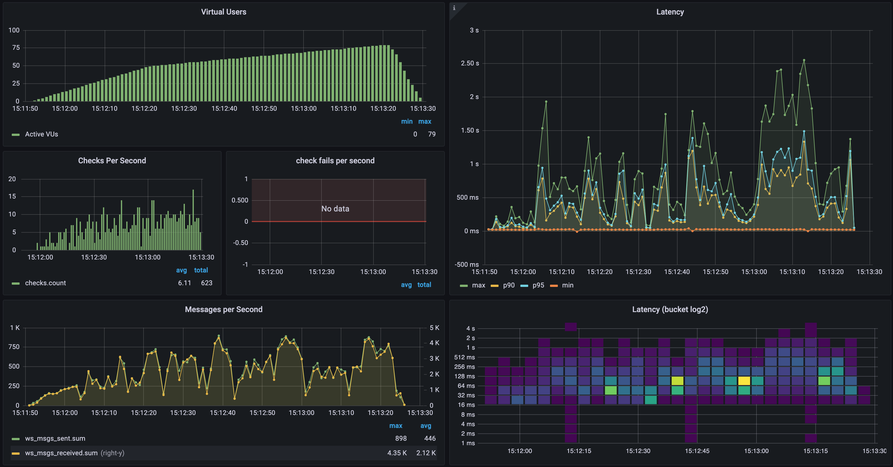

## load test with websocket

This part assumes that you already understand load testing for HTTP connections.

### Example

You can find an example script in the
[`./scripts`](./scripts/example-websocket-scenario.js) folder

### Create a scenario

The main difference with HTTP is that for HTTP, duration has a simple
meaning and is therefore measured automatically by k6. When you send
messages over a websocket connection, this meaning is business
dependant and you will have to create your own metric for your
scenario.

*For instance in the example script, a message is sent to the server
and then redispatched to all other clients. The "duration" of this
business interaction is the duration between the creation of the
message by the first client and the reception by all other clients, so
there are as many durations as there are connected clients for one sent
message.*  
*Another use case would be an application that sends updates of a
server data to the client who owns this data. In that case the
performance is the duration between the moment the server creates the
message and the moment the client receives the message*  
*A last use case is if a server needs to react to messages coming from
the clients but the clients never know if the messages are
acknowledged.  You would not be able to measure the duration from the
client, this would be a server metric. (For this case, you can
probably use HTTP calls instead of websocket)*

If you want to make sure the performances are good under load, you
have to make sure that your implementation allows you to know when the
interaction begins and ends.

You can also simplify this process by sending pong with timestamp as
payload and listen to pongs. You lose the measure of each interaction,
but you can see that the server is still alive and well.

>In the example a timestamp is put in the message from the client,
>and the timestamp is forwarded by the server in order for all
>clients to measure their latency.

### Running a scenario

The main difference with HTTP is that the chances you exhaust the
resources of your machine before the server are greater because the
number of messages can quickly become large. This means you have to
monitor your server and your laptop to check which seems to saturate
first.

### Visualize the test when it runs

You need to use the grafana configuration for websocket.

You can switch between `ws_ping` and `ws_latency` as `trend` variable
to display your business latency or the ping latency. It is
required that you created a metric called `ws_latency` (`new
Trend('ws_latency')`) for this to work.

The two main differences are:
- There is no notion of URL (or request tagged with a name) you have
to create it if your websocket use a custom routing.
- A block displays the number of messages sent and received for all
VUs so you can check the consistency with the predicted volume for
your scenario.

To understand the other blocks please refer to the
[README](./README.md#visualize-the-test-when-it-runs).

### Analyse the results

If you use the `ws_ping` latency, you have to know that it is not
utterly representative of the performance perceived by your end
users. Ping is optimised for latency and there are no business logic
executed.

Cf [README](./README.md#analyse-the-results)
